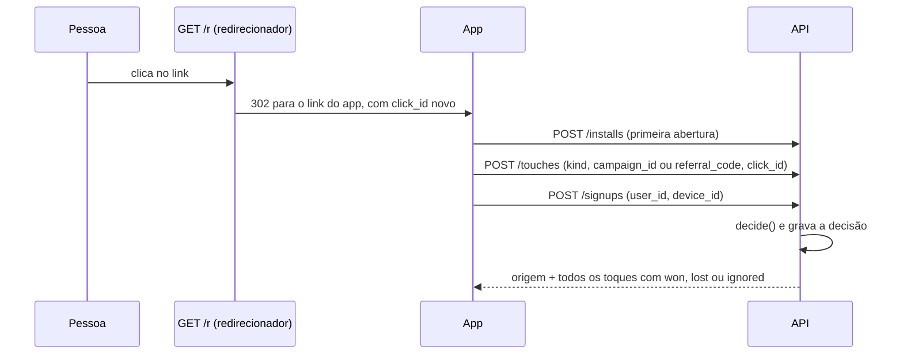
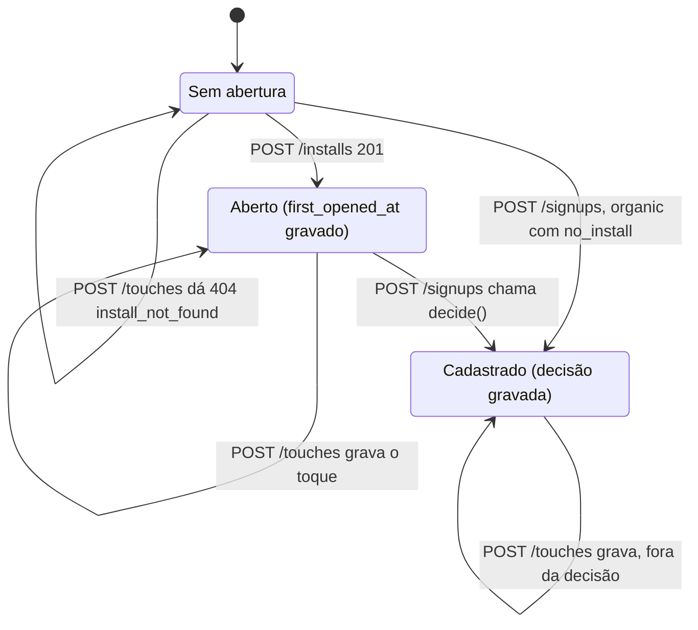
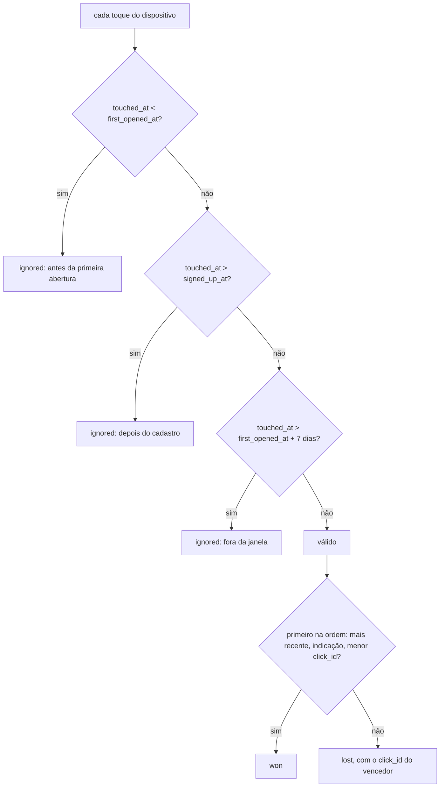
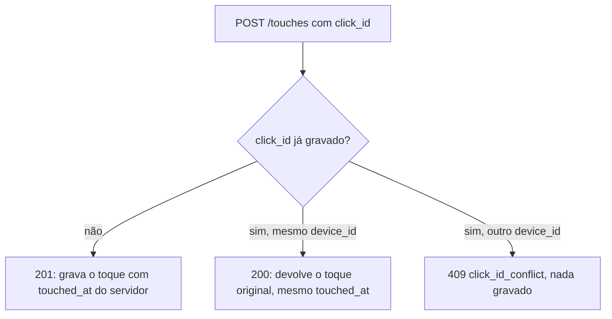

# Conty. Origem do cadastro no app

API que decide de qual link veio um cadastro no app. O link de campanha ou de indicação abre num webview sem referrer, então tudo viaja na query. O app grava a primeira abertura e os toques. No cadastro, uma função pura escolhe o toque vencedor e a decisão fica gravada para auditoria.

## Visão rápida

| Como avaliamos | Onde está a regra | Teste que prova |
| --- | --- | --- |
| Cadastro sem origem fica marcado como orgânico, com o motivo gravado, não como dado faltando silencioso. | `src/attribution.ts` (`decide`), `src/db.ts` (CHECK em `origin_reason`) | `api.test.ts`: "cadastro sem toque é orgânico, com o motivo gravado" |
| O mesmo clique não cria duas origens. | `src/tracking.ts` (`registerTouch`), `src/db.ts` (PK em `click_id`) | `api.test.ts`: "o mesmo click_id não cria duas origens: uma linha, mesmo touched_at, mesma origem" |
| Toque fora da janela ou posterior ao cadastro não vence. | `src/attribution.ts` (`ignoredReason`) | `api.test.ts`: "toque fora da janela vira ignorado e o cadastro fica orgânico com motivo no_valid_touch" e "link aberto depois do cadastro não conta: a decisão gravada não muda" |
| A janela de validade da origem está explícita. | `src/attribution.ts` (`DEFAULT_POLICY`) | `api.test.ts`: "a janela é a da política injetada e aparece na resposta" |
| Dá para auditar por que aquele cadastro recebeu aquela origem. | `src/tracking.ts` (`signUp`, `getSignup`) | `api.test.ts`: "GET devolve a decisão gravada, não recalculada com a política de hoje" |

## Como rodar

Node 22 ou mais novo.

```bash
npm install
npm test
npm run typecheck
npm start
```

A API sobe em `http://127.0.0.1:3006` e grava em `data/origem.sqlite`. `PORT` e `DB_PATH` mudam isso (veja `.env.example`). Na subida, `src/seed.ts` cadastra estes dados:

| O quê | Valor |
| --- | --- |
| Campanha | `cmp_verao`, `cmp_creators_br` |
| Código de indicação | `ANA10`, `BRUNO7` |

## O contrato de atribuição



**O que viaja no link.** Tudo na query, nada de referrer:

| Parâmetro | Quando | Quem gera |
| --- | --- | --- |
| `kind` | sempre: `campaign` ou `referral` | quem monta o link |
| `campaign_id` | `kind=campaign` | quem monta o link |
| `referral_code` | `kind=referral` | quem monta o link |
| `click_id` | sempre | o redirecionador, um por clique |

Exemplo de link de campanha, o que a pessoa clica:

```text
http://127.0.0.1:3006/r?kind=campaign&campaign_id=cmp_verao
```

O redirecionador responde `302` para o link que o app recebe:

```text
https://app.conty.com.br/abrir?kind=campaign&campaign_id=cmp_verao&click_id=clk_d5ad964b-3900-414d-9226-f09ed87bef15
```

Exemplo de link de indicação:

```text
http://127.0.0.1:3006/r?kind=referral&referral_code=ANA10
https://app.conty.com.br/abrir?kind=referral&referral_code=ANA10&click_id=clk_d5f3e128-4df9-4d23-be92-f57315a93363
```

**O que o app grava na primeira abertura.** `POST /installs` grava `first_opened_at` uma vez só. Abrir de novo devolve o valor original. Cada link aberto vira um toque com `POST /touches`, com o `touched_at` do servidor.

**Como o cadastro consome isso.** `POST /signups` lê a abertura e todos os toques do dispositivo, chama `decide()` e grava o resultado em `signups`.



## Regra de qual toque vence

Implementada em `src/attribution.ts`, em `decide(touches, firstOpenedAt, signedUpAt, policy)`. É função pura, sem banco e sem relógio.

**Janela de validade: 7 dias (`windowMs = 604800000`), contados da primeira abertura do app.** Ela vem de `DEFAULT_POLICY`, entra em `createApp(db, { policy })` e aparece na resposta do cadastro (`window_ms`, `window_ends_at`).

Um toque conta se `first_opened_at <= touched_at <= min(first_opened_at + janela, signed_up_at)`. Os limites valem: um toque exatamente no fim da janela ou no instante do cadastro conta. Fora disso o toque é `ignored`, com o motivo:

- antes da primeira abertura do app;
- depois do cadastro (link aberto depois do cadastro não conta);
- fora da janela.



Entre os toques que contam, **o mais recente vence**. Empate de horário, nesta ordem:

1. indicação vence campanha;
2. mesmo tipo: o menor `click_id` vence.

O resultado é determinístico: a ordem em que os toques chegam não muda nada. Cada toque sai com `outcome` (`won`, `lost` ou `ignored`) e `reason` em português.

Sem toque que conte, o cadastro é `organic`, com `origin_reason` gravado:

| `origin_reason` | Quando |
| --- | --- |
| `last_valid_touch` | há vencedor (a origem é `campaign` ou `referral`) |
| `no_touch` | o dispositivo não abriu nenhum link |
| `no_valid_touch` | havia toques, todos ignorados |
| `no_install` | não há primeira abertura registrada para o dispositivo |

Exemplo, saída real de `decide()`:

```text
2026-10-01 12:00  primeira abertura                    janela começa
2026-10-01 13:00  clk_cmp    campanha   cmp_verao        lost     Perdeu para clk_ref: toque mais recente vence.
2026-10-02 13:00  clk_ref    indicação  ANA10            won      Toque válido mais recente.
2026-10-08 12:00                                       janela acaba (+7 dias)
2026-10-09 13:00  clk_tarde  campanha   cmp_creators_br  ignored  Fora da janela de 7 dias contada da primeira abertura (até 2026-10-08T12:00:00.000Z).
2026-10-10 14:00  cadastro   origin: referral, origin_reason: last_valid_touch
```

O cadastro no dia 10 ainda herda a indicação do dia 2. A janela vale para o toque, não para o cadastro.

## Endpoints

| Método e caminho | Corpo | Sucesso |
| --- | --- | --- |
| `GET /r?kind=&campaign_id=&referral_code=` | | 302 para o link do app |
| `POST /installs` | `{ "device_id" }` | 201 (nova), 200 (já existia) |
| `POST /touches` | `{ "device_id", "click_id", "kind", "campaign_id" ou "referral_code" }` | 201 (novo), 200 (mesmo clique) |
| `POST /signups` | `{ "user_id", "device_id" }` | 201 (novo), 200 (mesmo usuário) |
| `GET /signups/:user_id` | | 200, a decisão gravada |

Os erros têm a forma `{ "error": "mensagem", "code": "codigo" }`:

```text
422 invalid_body, device_id_required, click_id_required, user_id_required,
    kind_invalid, campaign_id_required, referral_code_required
404 link_target_not_found, install_not_found, signup_not_found
409 click_id_conflict, user_already_signed_up
```

A validação do corpo vem antes da checagem de estado.

## A resposta do cadastro (auditoria)

`POST /signups` e `GET /signups/:user_id` devolvem a mesma coisa: todos os toques considerados e o motivo de cada um.

```json
{
  "user_id": "usr_ana",
  "device_id": "dev_ana",
  "signed_up_at": "2026-10-11T08:20:43.251Z",
  "origin": "referral",
  "origin_reason": "last_valid_touch",
  "winning_click_id": "clk_d5f3e128-...",
  "touches": [
    { "click_id": "clk_d5ad964b-...", "kind": "campaign", "ref": "cmp_verao", "touched_at": "...", "outcome": "lost", "reason": "Perdeu para clk_d5f3e128-...: toque mais recente vence." },
    { "click_id": "clk_d5f3e128-...", "kind": "referral", "ref": "ANA10", "touched_at": "...", "outcome": "won", "reason": "Toque válido mais recente." }
  ],
  "first_opened_at": "2026-10-11T08:20:43.202Z",
  "window_ms": 604800000,
  "window_ends_at": "2026-10-18T08:20:43.202Z",
  "rule": "O toque válido mais recente vence. Empate de horário: indicação vence campanha; mesmo tipo, menor click_id vence."
}
```

O `GET` lê o JSON gravado no cadastro. Não recalcula. Se a política mudar depois, a auditoria continua mostrando o que valeu na hora. Um toque que chega depois do cadastro é aceito e gravado, mas não entra na decisão gravada.

## O mesmo clique não cria duas origens



`touches.click_id` é chave primária, então nem uma corrida grava duas linhas. O cadastro também é idempotente por `user_id`.

[`EXEMPLOS.md`](EXEMPLOS.md) traz o fluxo inteiro com curl e as respostas reais.

## Onde está cada regra

```text
src/
├── app.ts          # rotas e validação do corpo
├── attribution.ts  # decide(), DEFAULT_POLICY (janela) e a regra de desempate
├── tracking.ts     # primeira abertura, toque e cadastro: leitura, escrita e idempotência
├── links.ts        # monta o link do app a partir do clique
├── db.ts           # schema SQLite; PK, CHECK e UNIQUE amarram o estado
├── seed.ts         # campanhas e códigos de indicação
└── index.ts        # sobe o servidor
test/
├── attribution.test.ts  # decide(): quem vence, empate, janela, limites
├── api.test.ts          # fluxo pela API: clique repetido, auditoria, erros
└── helpers.ts
```

## O que ficou de fora

- Autenticação e assinatura do link. Qualquer cliente pode forjar um `click_id` ou um toque.
- O servidor de redirecionamento real e o app. `GET /r` só mostra o contrato.
- Multi-toque (crédito dividido). A regra é último toque válido vence.
- Recalcular a origem de cadastros antigos com uma política nova.
- Interface.

## Com mais tempo

- Assinar o link (HMAC sobre `kind`, referência e `click_id`) para recusar toques forjados.
- Gravar o horário do clique no redirecionador e usá-lo como `touched_at`, em vez do horário em que o app avisa. Hoje um clique feito antes de instalar o app conta como toque na primeira abertura.
- Ponto ambíguo do enunciado: a janela vale para o toque (`touched_at` dentro dos 7 dias da primeira abertura), não para o cadastro. Quem se cadastra no dia 30 ainda herda um toque do dia 2. Se o produto quiser o contrário, a mudança é uma linha em `ignoredReason`.

## Uso de IA

- Feito com IA (Claude Code): a proposta do contrato (parâmetros do link, tabelas `installs`, `touches`, `signups`, janela e regra de desempate), o código, os testes (escritos antes da implementação e vistos falhar), a execução com curl de `EXEMPLOS.md` e este README, incluindo a tabela de visão rápida e os diagramas. A revisão do código não achou bug além dos que os testes vermelhos já mostraram.
- Revisado por mim: o formato do link de campanha e de indicação, a regra do toque válido mais recente com desempate por tipo e por click_id, a janela de 7 dias contada da primeira abertura e aplicada ao toque, o horário do toque como o momento em que o app avisa o servidor, o cadastro orgânico com motivo gravado, os testes e este README.
